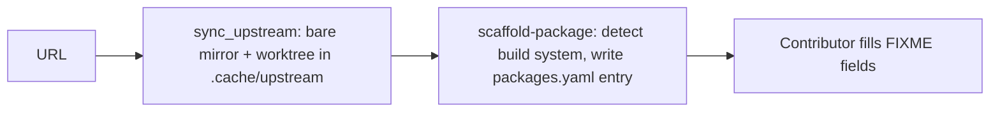

# COPR-0001. Add a new package from an upstream URL

**Tags:** #packages #onboarding

## User Story

As a contributor onboarding a new upstream project, I want one command to fetch its
source and scaffold its `packages.yaml` entry, so that I don't have to hand-write the
YAML boilerplate or clone the upstream by hand.

## Behavior

`make add-new URL=<repo-url>` syncs the upstream into the mirror cache under
`.cache/upstream/<org>/<name>` (see [COPR-0004](COPR-0004-version-auto-bump.md#upstream-mirror-cache)),
and writes a scaffolded `packages.yaml` entry — detecting the build system (`cmake`/`meson`/`autotools`/`make`/
`python`) and filling in what it can (license, summary, `depends_on` guessed from
`build_requires` matching existing package names, Python build-backend `Requires`).
Fields it can't determine are left as `FIXME` for the contributor to fill in.

`make scaffold-package PACKAGE=<name>` re-runs just the scaffold step against an
already-synced mirror (looked up by name under `.cache/upstream`); pass `URL=<repo-url>`
to sync a mirror that is not cached yet.

## Implementation

- `Makefile` `add-new` passes the URL to `scaffold-package`, which calls
  `lib.upstream.sync_upstream()` (there is no separate registration step).
- `scripts/scaffold-package.py` + `scripts/lib/detection.py` do the build-system and
  Python-project detection (PEP 621/Poetry metadata, `setup.py` regex fallback) and
  write the `packages.yaml` entry.
- `make list-tags PACKAGE=<name>` (or with no `PACKAGE`, for all upstreams) shows
  available upstream tags first, if useful before scaffolding.

## Quirks & Decisions

- Quirk: `delete-package` still holds the volume sweep in the Makefile recipe after
  its script call, so it's untestable by pytest.
  Proposed: move it into `scripts/*.py`, matching `scaffold-package.py`, which
  already fully delegates and is tested. (BUG-0070; the git-submodule surgery that
  used to live in `add-new`/`delete-package` went away with the submodules)

## Testing

### Unit

- `tests/test_scaffold_package.py`, `tests/test_detection.py`.

### Integration

- `tests/integration/test_make_targets.py` exercises `add-new`/`scaffold-package`
  via `make -n`.

## Status

Implemented
