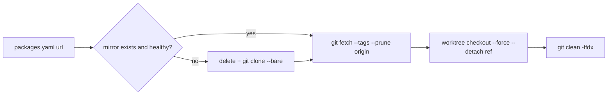

# COPR-0004. Auto-bump package versions from upstream

**Tags:** #versioning #upstream

## User Story

As a maintainer, I want each package's version to advance from its upstream git repo
automatically, per a policy I set once, so that I don't have to manually track and
bump 49 packages' versions.

## Behavior

`make update-versions` fetches the latest tag/commit for every upstream repo (see
[Upstream mirror cache](#upstream-mirror-cache)) and rewrites `packages.yaml`'s `version`/`source.commit` fields, according to each package's own
`auto_update.release_type`:

| Type | Behavior | Version format |
| --- | --- | --- |
| `latest-version` | latest semver tag only | `1.2.3` |
| `latest-tag` | latest version-like tag, any component count | `1.9` |
| `latest-commit` | latest commit on branch | `1.2.3^20240101gitabc1234` |
| `pinned-version` | pins to tag `v<version>`; no updates | - |
| `pinned-commit` | pins to `source.commit.full`; no updates | - |
| `pinned-tag` | pins to a specific non-semver tag | `0.53.0^20240101gitabc1234` |
| *(absent)* | try semver, fall back to commit | `1.2.3` or `0^20240101gitabc1234` |

Bumping a version also resets that package's `release: 0`, signaling the next build to
reset the release counter (see [COPR-0008](COPR-0008-release-numbering.md)).

`scripts/update-versions.py` handles Ctrl+C cleanly: `except KeyboardInterrupt:
sys.exit(130)`, same as the rest of the pipeline. (#BUG-0072)

`make validate-packages` warns (offline, no network) when a `latest-commit`/
`pinned-commit` package's `source.commit.date` is newer than a tag-pinned
`depends_on` sibling's pinned tag date — the drift class that broke
`hyprland-plugins` against `Hyprland` across all three chroots (runs 76–78) before
mock caught it. (#BUG-0056)

### Upstream mirror cache

Upstream sources are not git submodules. They live in a disposable, gitignored cache
under `.cache/upstream/`, derived entirely from the `url` fields in `packages.yaml`
(one entry per distinct URL; the first pin in `packages.yaml` wins for a shared URL):

| Path | What it is |
| --- | --- |
| `.cache/upstream/<org>/<name>.git` | bare mirror: `+refs/heads/*:refs/remotes/origin/*` plus tags, so `origin/<branch>` and `refs/tags/X` resolve exactly as they did in the submodule checkouts |
| `.cache/upstream/<org>/<name>/` | detached worktree of that mirror at the resolved ref (relative worktree paths, so it resolves inside the `/work` container mount) |

- The cache holds no state: deleting `.cache/upstream` costs only a re-fetch, and the
  next `make update-versions` (or `make upstream-sync`) rebuilds it.
- A missing or corrupt mirror is deleted and re-cloned automatically.
- The worktree is reset on every sync, so it can never stay dirty.
- Nothing in the superproject tracks it: no gitlinks, no `.gitmodules`, nothing for
  `make update-daily` to commit.

Every warn-and-continue site along the way (an upstream that doesn't exist, a
`git fetch`/`switch`/`checkout` failure, an unresolved pin, a `fetch_tags()`
failure/timeout, no version-like tag found, an unknown `release_type`, a
conflicting pin) also collects a `Failure(scope, kind, detail)` alongside its
existing stderr print. At the end of the run:

- an aggregated block prints to stdout after the YAML summary, grouped by
  `kind`, so a run with one real outage doesn't scroll past unnoticed among
  routine per-package lines;
- when non-empty, the same report is written to
  `logs/.update-versions-failures.md` (removed when there are no failures, so
  a stale file from a previous failing run can never be read as tonight's);
  `scripts/pkg-log-analysis.py` folds it into `docs/nightly-summary.md`'s
  `## Upstream version refresh` section when `make stage-log-analyze` runs
  (#COPR-0022);
- `_update-daily`'s closing banner echoes the failure count next to the
  existing "N package(s) updated tonight" line.

`make update-versions` still exits 0 when failures are collected: `Makefile`'s
`_update-daily` runs it as `$(MAKE) update-versions || exit 1`, so a non-zero
exit would abort the entire nightly over one flaky remote. Visibility, not
fatality — see `_update-daily`'s pattern for `full-cycle-matrix` (recorded via
`logs/.update-daily-failed`, not fatal either). (#BUG-0100)

## Implementation

- `scripts/update-versions.py` (`_run_parallel()`, `_resolve_package_version()`),
  `lib/version.py`, `lib/upstream.py` (`list_upstreams()`, `sync_upstream()`,
  `fetch_tags()`), `lib/paths.py` (`UPSTREAM_DIR`).
- Runs first in `make update-daily` (COPR-0003), before the quality gate.

## Quirks & Decisions

- Decision: every warn-and-continue site now also appends a `Failure` to an
  in-process list, rendered as one aggregated block (stdout) and one durable
  Markdown sentinel (`logs/.update-versions-failures.md`, folded into
  `docs/nightly-summary.md`) at the end of the run, instead of only ever
  scrolling past on stderr. The exit code stays 0 on partial failure — see
  `## Behavior` above for why. (BUG-0100, closed)
- Decision: `lib.upstream.fetch_tags()` (formerly `lib.gitmodules`) used to return a bare `list[str]`,
  so a failed/timed-out `git ls-remote` and a genuinely tagless upstream were
  both `[]` — indistinguishable, and the single most common real network
  failure for tag-based packages was silently swallowed. It now returns
  `TagFetch(tags, error)`; `error` is non-`None` only on an actual fetch
  failure. (BUG-0100, closed)
- Decision: `UPDATE_VERSIONS_JOBS` (default 8; `1` = strictly serial) runs the
  upstream-sync loop and the per-package version-resolution loop each across
  a `ThreadPoolExecutor`. Safe without any locking: `lib.upstream` always
  uses `git -C <repo>` (never `cwd=`/`os.chdir`, so no process-global cwd
  hazard), the url-derived registry has no duplicate urls (no two tasks ever touch
  the same mirror), and every worker writes only its own dict key
  (`url_to_ref[url]`, `pkg_to_latest[pkg]`, `pkg_to_commit_info[pkg]`) --
  CPython's GIL makes those individual writes atomic, and nothing downstream
  reads a dict's *iteration* order (the stdout summary and `packages.yaml`
  rewrite both iterate `packages.yaml`'s own order, not the dicts'). The one
  real hazard was output, not git: `failures` is appended to from every
  worker, so append order became completion order, and the two render
  functions above already sorted only by `kind` -- fixed by also sorting each
  kind's group by `scope`, so the committed `docs/nightly-summary.md` stays
  byte-stable regardless of thread completion order. Each multi-line stderr
  warning (e.g. a fetch failure plus its detail) is now one `print()` call
  instead of two, so one thread's output can't land in the middle of
  another's. (BUG-0101, closed)
- Decision: git submodules were dropped in favour of the url-derived mirror cache. The
  gitlinks recorded nothing we use (every run fetches origin and switches to a
  tag/branch/commit anyway), conflicted between branches, needed `ignore = dirty`,
  and made `update-daily` commit moved gitlinks. The cache is not a container volume:
  host-side scripts (`update-versions`, `scaffold-package`, `validate-packages`) read
  it too, and the `/work` bind mount already makes it visible inside every
  container. Worktrees use relative paths (`worktree.useRelativePaths`, git >= 2.48)
  so the same tree resolves on the host and under `/work`. Vendoring is unaffected:
  `lib/vendor*.py` build from hash-verified archive tarballs, never from the cache.
- `update-versions.py` now exits cleanly (130) on Ctrl+C instead of a raw traceback.
  (BUG-0072, closed)
- Decision: the drift check (`lib.validation.validate_dependency_drift()`) is
  offline and degrading — it reads only local mirror git state via the existing
  `lib.upstream.get_tag_commit()`, and skips silently (no warning) when a
  mirror is absent or the tag isn't fetched locally, so CI and fresh
  clones stay green. It warns rather than errors: a commit-tracked package being
  ahead of a pinned sibling is common and often correct — the point is making the
  drift visible, not blocking on it. (BUG-0056, closed)

## Testing

### Unit

- `tests/test_update_versions.py` (incl. `TestConcurrency`: `UPDATE_VERSIONS_JOBS=1`
  vs `=8` produce byte-identical stdout/packages.yaml/failure sentinel; a failing
  upstream doesn't abort its siblings; `jobs=1` never touches
  `ThreadPoolExecutor`), `tests/test_version.py`, `tests/test_upstream.py`
  (real bare mirror + worktree against a local origin: first clone, pinned
  tag/commit/branch re-sync, corrupt-mirror recreate, dirty worktree reset,
  `TagFetch`), `tests/test_pkg_log_analysis.py` (folding the failure report into
  `docs/nightly-summary.md`).

## Status

Implemented
